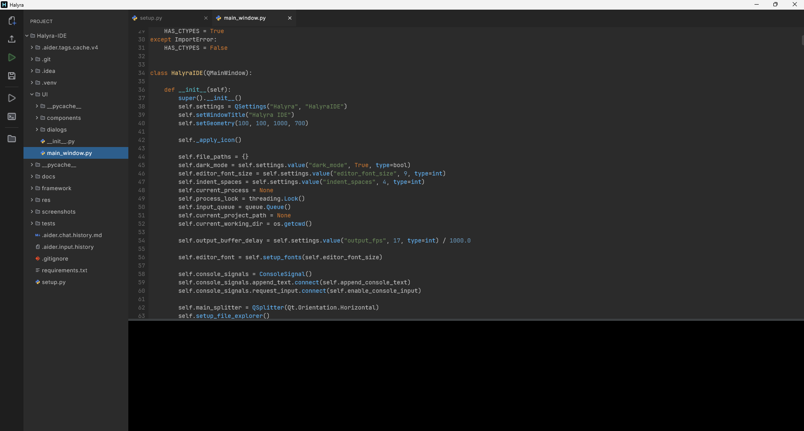

# Halyra
A lightweight Python IDE for fast prototyping of your choice

**Write, Run, and iterate on Python without the overhead of a full sized IDE**



---
## Building
```bash
git clone https://github.com/aavarvdXD/Halyra.git
cd Halyra
./gradlew createDistributable
```
**Requires Java 17 or higher and Python installed and available on** `PATH`  
If you're on Windows, execute `gradlew.bat createDistributable` instead of `./gradlew createDistributable`  

If you just want to run it then use `run` instead of `createDistributable`, or you could also visit the releases page for direct download

---
## Features
- **Prototyping Mode**: Execute Python code directly from the editor without needing to save a file first. If no file is saved, a temporary `halyra_proto_*.py` file is created and deleted after execution.
- **Multi-Tab Support**: Open multiple files, switch between them, and scroll through tabs when they exceed the screen width
- **Smart Editor**: 
    - Auto-closing of `()`, `[]`, `{}`, `"`, and `'`.
    - Python-style auto-indentation: Automatically adds current indentation + 4 spaces after a newline following `:`
    - Code Completion: Type with a popup recommending you what to type next
- **Integrated Terminal**: Resizable vertical terminal for output and input
- **Project Explorer**: A file tree with icons for quick navigation and file management
